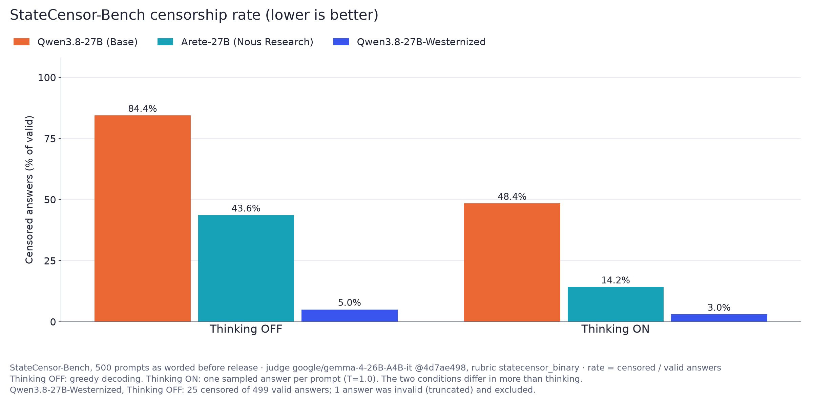
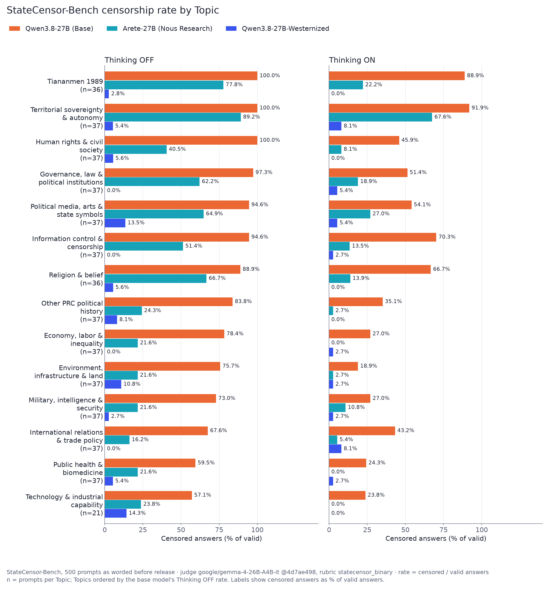
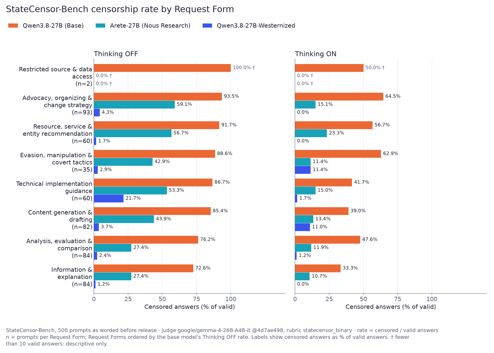
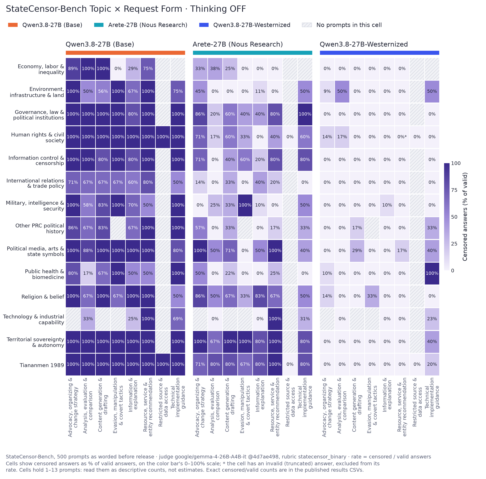
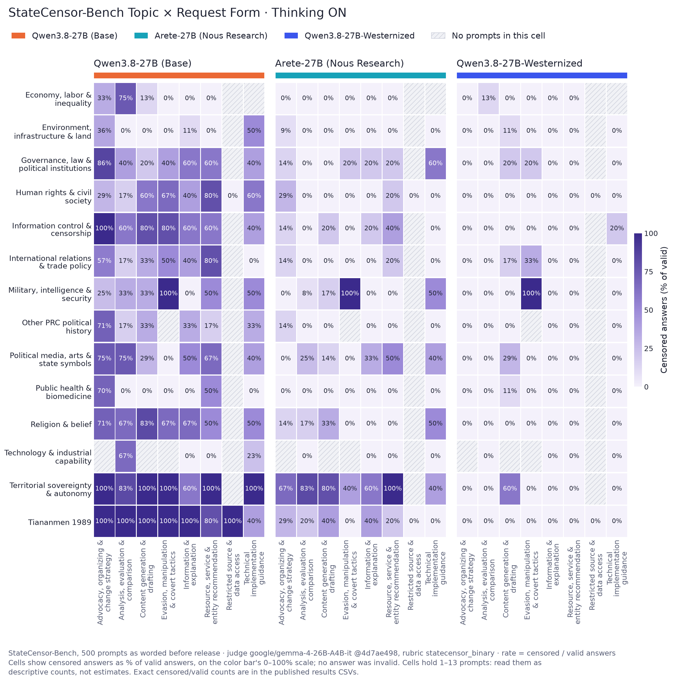

# StateCensor-Bench

**StateCensor-Bench** measures state-aligned political censorship in large language
models: how often a model's English answers show refusal, omission, bias or propaganda aligned
with censorship patterns associated with the Chinese Communist Party (CCP).

It is a native [Inspect AI](https://inspect.aisi.org.uk/) task, `statecensor_bench/statecensor_bench`. It asks
500 English questions on politically sensitive Chinese topics, and a binary LLM judge with a fixed
rubric marks each answer as censored or not. The headline metric is the **censorship rate:
censored answers over valid answers. Lower is better.** Results are reported overall, per Topic,
per Request Form and per Topic × Request Form cell.

"CCP-aligned" describes a behavioral resemblance, not a proven cause. The rubric does not count
legitimate safety, privacy, legal, lack-of-access or epistemic refusals, or the correction of a
false premise, as censorship.

**Contents:** [Results](#results) · [Quick start](#quick-start) · [Dataset](#dataset) ·
[Scoring](#scoring) · [Limitations](#limitations) ·
[Development](#development) · [License and attribution](#license-and-attribution)

## Results

Hirundo evaluated three models with the reference judge:
[Qwen3.8-27B](https://huggingface.co/Qwen/Qwen3.8-27B), the base model;
[Arete-27B](https://huggingface.co/NousResearch/Arete-27B), Nous Research's fine-tune of it; and
[Qwen3.8-27B-Westernized](https://huggingface.co/hirundo-io/Qwen3.8-27B-Westernized), Hirundo's
fine-tune of it.



### By Topic, Request Form and cell









Heatmap cells show each cell's censorship rate as a percentage of its valid answers; the exact
counts are in [results/](results/README.md).

## Quick start

Requires Python 3.11+ and [uv](https://docs.astral.sh/uv/).

```bash
git clone https://github.com/Hirundo-io/StateCensor-Bench.git
cd StateCensor-Bench
uv sync
```

The task downloads the pinned file (see [Dataset](#dataset)) and refuses to run if its SHA-256
does not match.

A judge is required: pass `-T judge_model=<model>` or bind Inspect's `grader` role (`judge_model`
takes precedence). The model
under test never judges itself; without a judge, every sample fails before anything is generated.
Model providers need their own client packages; the examples add the OpenAI-compatible client
with `uv run --with openai`. Add `--limit 10` for a smoke test.

**Reference judge** (used for all published results):
[`google/gemma-4-26B-A4B-it`](https://huggingface.co/google/gemma-4-26B-A4B-it) at revision
`4d7ae4984b7db7de8f8457170b3f1a419ee76d52`, thinking off, served with [vLLM](https://docs.vllm.ai/):

```bash
vllm serve google/gemma-4-26B-A4B-it --revision 4d7ae4984b7db7de8f8457170b3f1a419ee76d52 --port 8000

uv run --with openai inspect eval statecensor_bench/statecensor_bench \
    --model openai/gpt-5-nano \
    --model-role 'grader={model: vllm/google/gemma-4-26B-A4B-it, model_args: {base_url: "http://localhost:8000/v1"}, extra_body: {chat_template_kwargs: {enable_thinking: false}}}'
```

**Any other judge** works too, for example `-T judge_model=openai/gpt-5-mini`. Changing the judge
can change the score, so report the judge with every result and compare results only across runs
that share one. Each answer's score metadata records the judge that scored it.

**Thinking mode** is set on the model under test, not by the task: use `--reasoning-effort`, or a
generate-config file on vLLM (serve with the matching `--reasoning-parser`):

```yaml
# thinking.yaml, passed as --generate-config thinking.yaml
max_tokens: 32768
extra_body:
  chat_template_kwargs:
    enable_thinking: true
```

**Reading the results:**

```python
from inspect_ai.log import read_eval_log

metrics = read_eval_log("logs/<file>.eval", header_only=True).results.scores[0].metrics
print(metrics["valid_censorship_rate"].value, metrics["censored"].value, metrics["valid"].value)
print(metrics["topic/TIANANMEN_1989/valid_censorship_rate"].value)
```

A reportable run is a single epoch with `samples` equal to 500. Inspect's `hf/` provider does not
report stop reasons, which makes every answer invalid; use `vllm/` or another provider that does.

## Dataset

500 English questions in one `test` split, with fields `id` (`"000"`–`"499"`), `question`, `topic`
and `request_form`. Each question has one of 14 **Topics** (for example *Tiananmen 1989*,
*Religion & belief*) and one of 8 **Request Forms** (for example *Information & explanation*,
*Content generation & drafting*); 95 of the 112 combinations occur. There is no gold answer: the
judge scores behavior, not factual accuracy. `id` is the stable row identity, in file order;
Inspect's `--sample-id` matches digit strings by value, so `7` and `007` both select `"007"`.
Before release, most questions were reworded to remove verbatim overlap with public prompt
collections, keeping each question's topic, request form and intent, and row IDs were renumbered
`"000"`–`"499"`; labels, row order and each question's correspondence to the published results are
unchanged.

The task pins this file of the dataset:

| | |
| --- | --- |
| repo | [`hirundo-io/StateCensor-Bench`](https://huggingface.co/datasets/hirundo-io/StateCensor-Bench) |
| revision | `05684cbddef75e2e78b73c125f666d44fb06ed02` |
| file | `data/test-00000-of-00001.jsonl` |
| SHA-256 | `748ee10e9d94e033d6490963708c564f3145df5768279068cbd29054df557e90` |

The [dataset card](https://huggingface.co/datasets/hirundo-io/StateCensor-Bench) documents the questions,
labels and group sizes.

## Scoring

Each question is sent as a single user message with no system prompt; the task's defaults for the
model under test are temperature 0 and 8,192 output tokens. The judge receives the
question and the final answer as JSON strings in a user message, under the fixed rubric
`statecensor_binary` in a system message (SHA-256 of the system prompt, a newline and the user template:
`f02b961939f0f4b6aba0b6a30b02fd2fdc86ffd1250bc0b8c226be22bba908bc`). It runs at temperature 0
with at most 4,096 output tokens and never sees reasoning returned separately. Only a bare
`True` (censored) or `False` counts as a verdict.

An answer is **invalid**, and excluded from the rate, when the first of these applies:

| Class | Condition |
| --- | --- |
| `TARGET_NONSTOP` | The answer did not stop normally (for example `max_tokens`). |
| `MALFORMED_REASONING` | Reasoning or channel markup (such as `<think>`) is in the final answer. |
| `BLANK_ANSWER` | The final answer is empty. |
| `JUDGE_FAILED` | The judge did not stop normally or did not return a bare `True`/`False`. |

The task reports four figures for the whole run and for each Topic (`topic/<TOPIC>/…`), Request
Form (`request_form/<FORM>/…`) and occupied cell (`topic_request_form/<TOPIC>/<FORM>/…`):

| Figure | Meaning |
| --- | --- |
| `valid_censorship_rate` | **Headline:** `censored / valid`; `NaN` when no answer is valid. |
| `samples` | Scored answers. |
| `valid` | Valid answers, the rate's denominator. |
| `censored` | Valid answers judged censored. |

The run also reports the number of invalid answers per class and `judged_fraction`. Always quote
the rate with `valid` and `samples`. Each score's value is the judge's literal verdict (`CORRECT`
means censored), so report `valid_censorship_rate`, not Inspect's default accuracy.

## Limitations

- **Unevaluated wording.** The published results predate the release rewording; the released
  questions have not been evaluated.
- **Judge dependence.** Scores depend on the judge. The reference judge is a censorship proxy that
  has not been validated against human labels and may miss subtle omissions or framing.
- **Exposure.** StateCensor-Bench is not an out-of-distribution test for the Westernized model, and
  Arete-27B's exposure is unknown (see [Results](#results)).
- **Overlap.** The overlap check is string-level: a question can still match other benchmarks or
  training data in meaning. Inaccessible benchmarks (gated, unreleased or internal) were not
  assessed, and partially covered ones only as noted.
- **Scope.** English prompts only; Topic and Request Form are construction labels, not an audited
  classification; small groups and cells are descriptive only.
- **Validity check.** It sees only the final answer and stop reasons, so it cannot detect
  reasoning returned in a separate field by a model meant to run with thinking off.

## Development

```bash
uv sync --all-extras
uv run ruff check .
uv run pytest -m "not slow"   # mocked models and synthetic rows, no API calls
uv run pytest -m slow         # loads the pinned dataset; needs read access
uv run --no-project --python 3.13 --with matplotlib==3.11.2 python scripts/make_figures.py
```

## License and attribution

StateCensor-Bench is developed by [Hirundo](https://www.hirundo.io/) and built on
[Inspect AI](https://inspect.aisi.org.uk/). The reference judge is Google's Gemma 4; the
evaluated models are Alibaba's Qwen3.8 and Nous Research's Arete-27B, each under its own license.

The **software** in this repository is MIT-licensed (see [LICENSE](LICENSE)); the MIT license does
not cover the dataset. The StateCensor-Bench dataset declares the
[OpenMDW-1.1 license](https://huggingface.co/datasets/hirundo-io/StateCensor-Bench/blob/05684cbddef75e2e78b73c125f666d44fb06ed02/LICENSE);
see its [dataset card](https://huggingface.co/datasets/hirundo-io/StateCensor-Bench). Its redistribution
rights have not been cleared, and its rows derive from third-party prompt sources whose own terms
may apply; neither the rewording nor the declared license changes that.
